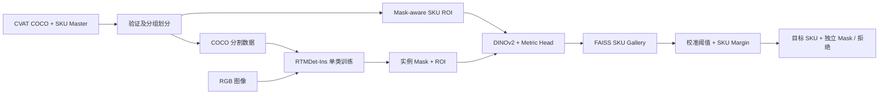

# 架构

模块化单体，FastAPI 负责 HTTP、常驻推理与训练进程管理。dataset 从唯一 COCO 来源生成两套数据；catalog 保存身份主表；training 调用 MMDetection Runner 或冻结 DINOv2 的映射层训练；registry 使用不可覆盖的版本目录。

Adapter 采用 Protocol，只有 load/predict 或 extract_embedding/unload/get_model_info。管线不读取模型内部结构。检索接口 build_index/search/add_sku/remove_sku，按 SKU 汇总多个参考图。OCR 仅接口，不安装实现。

训练任务通过 conda run 子进程，stdout 落本地日志，不阻塞 HTTP。API 与训练无需混装环境。模型版本由配置明确路径切换，需重启服务，前端模型列表只读显示当前注册版本。无云服务、在线推理、3D 或机器人模块。
