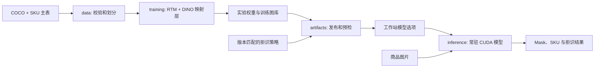

# 架构

源码统一放在 `retailvision/`，按现有业务职责划分。模块内部使用平级文件；CUDA 后端保留独立适配器。

```text
retailvision/
  api/          HTTP 路由及请求、响应契约
  data/         COCO 校验、准备、划分与 SKU 主表
  training/     RTM/DINO 训练、联合任务、进程和实验记录
  inference/    推理管线、常驻模型、图库与拒识
    backends/   ONNX Runtime / TensorRT 适配
  artifacts/    权重注册、工作站配置、预检与发布
  evaluation.py
  image_ops.py  训练与推理共用的 Mask/ROI 操作
  logging.py
  paths.py
```

`frontend/` 通过 HTTP 使用后端。`tools/` 保留 CLI 入口和部署工具；训练与推理代码不导入 HTTP 层。训练参数契约位于 `training/options.py`，CLI 与训练 API 共用校验。数据 API 支持与 CLI 相同的采集组划分、显式整图留出和不划分模式。



`api/app.py` 接收 HTTP 请求；`inference/runtime.py` 管理唯一常驻模型、切换和锁。图库写入由 `inference/gallery_edits.py` 负责快照、保存和校准失效。前端商品名称解析使用 Catalog API，仅按已解析的 SKU 筛选已有候选，不再实现另一套名称匹配规则。

`artifacts/registry.py` 保存不可覆盖的权重版本；`artifacts/profiles.py` 列出工作站可运行配置。这两种清单分别表达权重资产与完整运行组合。后端可用性和正式加载共用 `artifacts/config.py` 的文件及版本预检，后端可用性另检查 CUDA 和环境依赖。

`tools/publish.py` 将已完成、已验证的联合实验发布为一个工作站选项：注册最佳权重、生成展开的推理配置、复制训练图库、核对映射层及数据版本、绑定明确提供的拒识策略，最后更新模型列表。已有版本拒绝覆盖，失败清理本次尚未完成的输出。发布不会自动推断阈值或声称完成校准。

`models/`、`datasets/`、`work_dirs/`、`results/`、`third_party/` 和 `environments/` 保持原有产物位置。根目录 `catalog/skus.json` 是默认 SKU 数据文件，已不包含 Python 模块。历史报告和实验脚本作为历史记录保留，其旧 Python import 路径不再作为当前入口；当前入口为 `./start-web`、`tools/*.py` 和 `retailvision.api.app:app`。

RTM/DINO 通过 Protocol 接口组合。训练、推理与评估共用 ROI 操作；训练保留独立 Conda 环境，推理保留 PyTorch、ONNX Runtime CUDA 与 TensorRT。所有正式模型计算要求 CUDA，权重和特征提取源码从本地加载。
